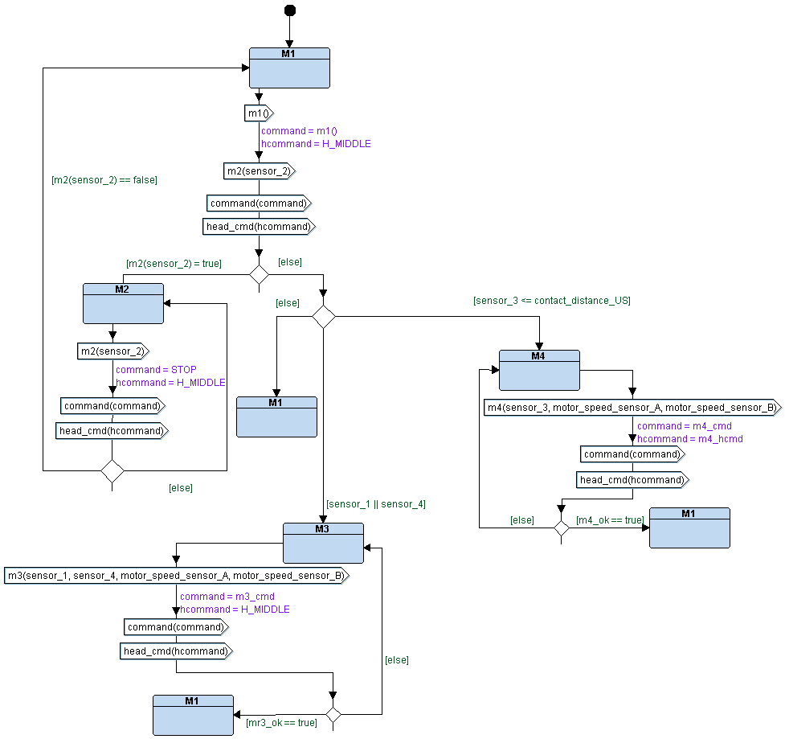
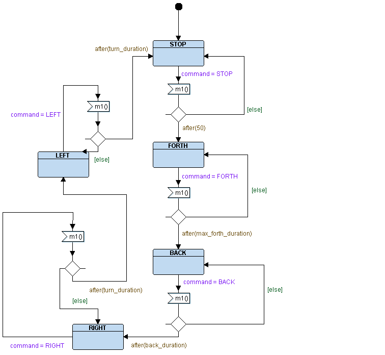
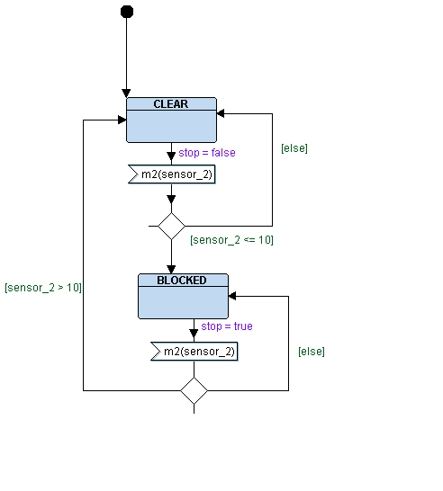
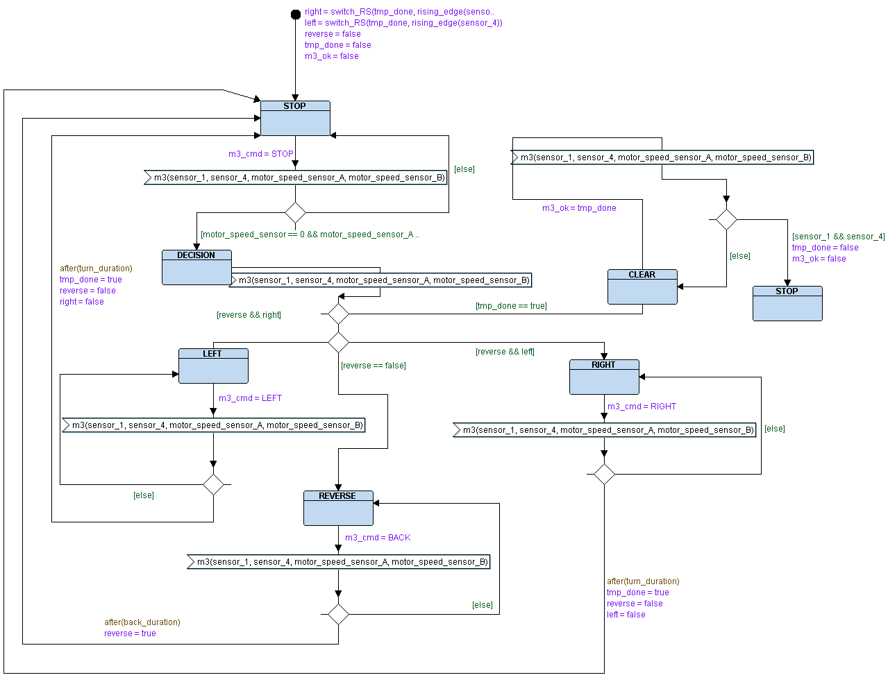
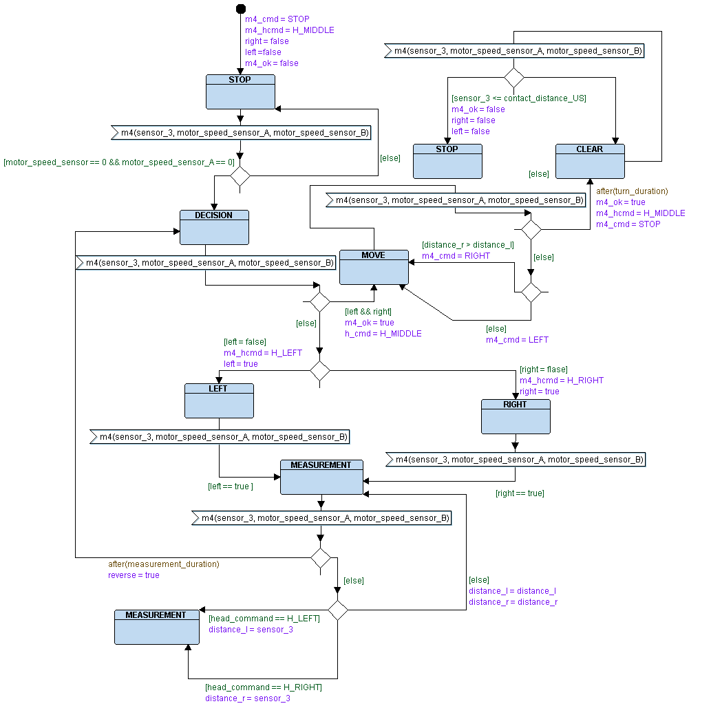

# Projet Robot Lego

# How to use the robot
Make sure to compile the repository on the host and local.
Compiling on the host is simple. Run the following command:

`make -f Makefile.hept compile`

After compiling on the host, the created compile output should
be copied into the robot. Make sure the robot is plugged into the host
via the USB cable provided with the robot. Then, run the following command:

`make -f Makefile.hept copy_src`

Enter the password when prompted.
Once the files are copied over, connect to the robot via SSH using the
following command:

`ssh robot@192.168.0.1`

Select yes when the connection prompt appears. Then, enter the password to
access the robot.

Navigate to the source folder with the following command:

`cd /home/robot/ev3dev−c/eg/robot_isae`

This is the destination in which the compiled files were copied to.
Now, build the application using the following command:

`make release`

Ignore the warnings that appear. Once the compilation is done,
simply run the application from the robot by navigating to the source
folder and selecting the robot_isae executable.

# Description of the project and of its implementation
The robot is a Lego Mindstor robot with an EV3. The module is equiped with a Texas Instrument AM1808 mono-core processor.
The robot has two front sensors at its bumper to detect collision. A head with an ultrasonic sensor to measure distance
to the nearest obstacle. Two front motors equiped with wheels for movement. And a colour sensor at its back to detect the
navigating the colour of its navigating surface.

The mission of the robot is to be able to navigate autonomously by detecting obstacles and readjusting its orientation when
it collides with an object. It should also be able to stop if it detects a dark surface or no surface at all. Four behaviours
have been programmed to achieve this mission. These behaviours are named: M1, M2, M3, and M4.

The following FSM diagram describes the robot behaviour:

**Actuation**

There are three motors on the robot that can be manipulated. The two front motors (motor_A, right motor; and motor_B; left motor) and the head motor (motor_C).

The front motors are controlled based on speed. They can be adjusted to turn clockwise or counterclockwise, based on the outputs `clockwise_A`, `counterclockwise_A`, `clockwise_B`, and `counterclockwise_B`. The extent of their actuation is controlled by speed (enabled by `cmd_speed_A` and `cmd_speed_B`). This is done through the variables `value_A` and `value_B` which defines the speed of their corresponding motors.

As for the head motor, it is controlled by position based on `cmd_position_C`. The magnitude of the angle is defined by `value_C`. It seems that there is a possibility to define the rotation direction based on `clockwise_C` and `counterclockwise_C`. However, it seems that modifying any of these variables does not affect the rotation direction.

**Command interpreter**

There are two possible commands the robot can use to actuate its motors. The `wheel_command` defined in _globals.ept_ and the `head_position` also defined in the same file. In order to interpret these commands and send the correct motor actuations, two interpreter nodes were programmed.

These two nodes are called in each states of the main node to command the robot.

**command(command_input)**

This node reads the command_input which is the wheel_command. It is a switch structure. It reads five possible values: STOP, FORTH, BACK, LEFT, and RIGHT. When STOP is read, it sends the values 0 to `value_A` and `value_B` and false to both motor A and B rotation directions. FORTH adjusts clockwise rotation and adjusts the speed to `forth_wheel_speed` defined in _globals.ept_. RIGHT and LEFT sets opposite rotation orientations on each front motors respectively and sets the speed to `turn_wheel_speed` defined in _globals.ept_. Finally, backwards sets both motors' rotation to counterclockwise and sets the speed to `back_wheel_speed` defined in _globals.ept_.

**head_cmd(head_command)**

This node reads the head_command which is the head_position. It is also a switch structure. There are three possible inputs to interpret: H_MIDDLE, H_LEFT, and H_RIGHT. In the node, I have set the possibility to adjust the rotation directions, but as mentioned above, it seems to do nothing. However, the node behaves as expected so these redundant lines were left as I had no chance to test them if they were removed.

If the node reads H_MIDDLE, it will set `value_C` to `head_front_angle` defined in _globals.ept_. Similarly if H_LEFT is read, it will set `value_C` to `head_left_angle` defined in _globals.ept_. And if H_RIGHT is read, it will set `value_C` to `head_right_angle` defined in _globals.ept_.

**M1 Behaviour**

When the program is launched, the robot intiates to behaviour M1.

The program structure of this behaviour follows a state machine. It is divided into four states based on four possible movements: Forth, Stop, Right, Left, and Back. At each state the program outputs the variable command. Which is read in the main program to actuate the front motors.

Initially the robot enters the STOP state. At this state the robot rests idle for 50 time units. Afterwards it goes to the FORTH state. Here the program sends a FORTH command for the duration of the forward movement. This duration is defined in _globals.ept_ by `max_forth_duration`. Once the duration is reached, the robot goes to the BACK state. The program sends a command, BACK. This state is maintained for the duration of the backwards movement defined as `back_duration` in the _globals.ept_. After the duration is elapsed, the program goes to RIGHT state and sends a command, RIGHT. This is maintained for the turning duration, `turn_duration` defined in _globals.ept_. Afterwards, the program enters LEFT state, sends the command LEFT for the same duration as RIGHT. Finally, the program returns to stop and repeats the process.

The robot can be interrupted during M1. Interruptions are modelled by behaviours M2, M3, and M4.

**M2 Behaviour**

M2 is activated when the robot's colour sensor (`sensor_2`) is blocked. Upon the activation of M2, the node m2 is ran and enters the BLOCKED state. In this state, the program sends the variable `stop`. Which is read in the main program to guard the state, M2. While in the M2 state, the main program sends the wheel command, STOP to stop the robot from moving. The robot returns to M1 state only if the colour sensor is unblocked, in which case, node m2 will return to the clear state and set the stop variable to false. Whichc is read by the main program and allows the robot to return to the M1 state.

**M3 Behaviour**

M3 is activated when either of the front bumper sensors are touched, normally when colliding with an obstacle. This is based on the input from `sensor_1`, right bumper, and `sensor_4`, left bumper.

State M3 runs the node, `m3`. In this node, the robot immediately enters a STOP state. The program waits for the robot to fully stop by reading the front motor speed sensors, `motor_speed_sensor_A` and `motor_speed_sensor_B`. In addition, it activates a switch node defined in _utils.ept_ as `switch_RS`. This switch is activated by the detected rising edge (node defined as `rising_edge` in _utils.ept_) on the corresponding bumper sensor. The switch is reset only if the variable `temp_done` is set to `true`. This variable stores information wheter or not the robot has moved away from the obstacle.

Once the robot has fully stopped, the next state is the DECISION state. In this state, node `m3` decides if the robot should move left or right, reverse, or to terminate the node. This deciison is based on the variable `tmp_done`, `reverse`, `right` and `left`. The variable `tmp_done`, as mentioned above, signals that the robot has succesfully cleared away from the obstacle. The variables `reverse`, `right`, and `left` defines if the robot has done the corresponding actions.

The order of the check in the BEHAVIOUR state is important. We want to make sure the robot follows the routine defined in the specification. The check for `tmp_done` should be done first, because the robot should first know if it is done. If this check happens in the lowest order, then the robot might ignore it and never terminate the node.

According to the specification, the robot should reverse first. In this case, at the DECISION state, after the first check is the verification if the reverse action has been done. At the start, this will be a `false`. In which case, the node enters the REVERSE state. In this state the node sends the command output, BACK. Then it sets the `reverse` variable as `true`, to indicate that the action is done. Then it will move backwards for the same `back_duration` seen in M1.

After reversing, the node goes back to STOP to halt the robot, then back the DECISION. In here, there are two possible transitions. The robot can either enter LEFT or RIGHT. It depends on which bumper was first touched when the node is first executed, which sets either `right` or `left` as `true`.

In either case, the robot will turn as the node will command the robot to turn either right or left. Afterwhich, the `tmp_done` will be set to `true` and the corresponding `right` or `left` variables will be reset to `false`. The node goes back to STOP and then back to DECISION. 

At this point, the node should be done with the routine and should read `tmp_done` as `true`. This leads to the CLEAR state which finally switches the `ok` variable to `true` to signal the final termination of the node. This is read by the main program which allows the program to return to M1 state.

Note about tmp_done and ok

tmp_done is necessary because I need a check to ensure that the robot has done reverse, left, and right. It is necessary that ok is a separate variable to mark the completion of the node. If tmp_done is read as output instead of ok, when tmp_done is set to true at the end of either the RIGHT or LEFT states, the node might exit earlier.

**M4 behaviour**

The final possible interruption is M4, which is activated if the ultrasonic sensor (`sensor_3`) detects an obstacle that is too close to the robot. This distance is defined to be 20 cm as assigned in _globals.ept_ by the variable `contact_distance_US`.

When this state is activated, it also triggers the `m4` node. The structure of this node is similar to `m3`. It begins with the robot stopping as it enters the STOP state. This time there are only three flags: the `left`, `right`, and `ok`. The `left` and `right` flags determine if the robot has rotated its head to either of those directions. The `ok` flag is used to define if the node routine is done.

After the robot fully stops, it enters the DECISION state. The order of the checks doesn't matter very much here as there are enough variables to cycle through to check all possible transitions. The first check is the `left` flag.

If detected `false`, the node enters the LEFT state. It sends the command to to turn the robot head to the left by sending H_LEFT. And, the `left` flag is set to `true`. Then the node enters the MEASUREMENT state. Here it reads the input of the ultrasonic sensor (`sensor_3`) to check the distance of the obstacle in front of the robot's view. This value is stored in `distance_r` and `distance_l`. There is a check to decide which variable should be modified based on the current head command. If it is detected to be H_LEFT, then it will store in `distance_l` and vice-versa. The robot maintains the MEASUREMENT state for the duration of `distance_measure_duration` defined in _global.ept_.

After the measurement, the node returns to DECISION, the head turns to the middle by the command MIDDLE_H, then the node continues to the RIGHT state and the process repeats accordingly. At the final return to DECISION, both `left` and `right` flags should be true and the next state would the MOVE state.

In the MOVE state, the node checks which recorded distances is further and turns to that direction. The turning is done by sending the command RIGHT or LEFT which is read by the main program. At this point the head position is also commanded to the middle. The turning is done until the turn_duration is reached.

At last, the node enters the DONE state, sends the STOP command, and flags `ok` to true. This flag is read in the main program and signals to exit the M4 state and return to M1.
